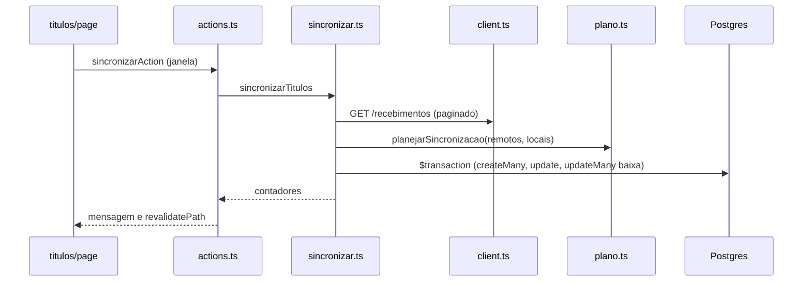
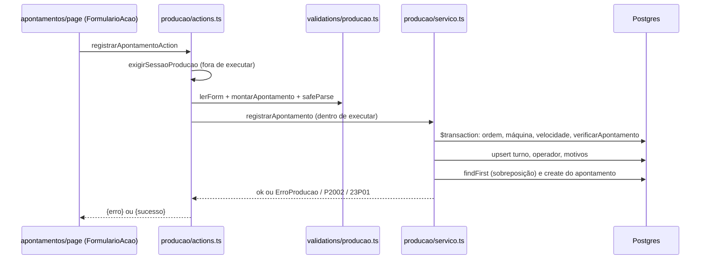

# Codebase Map

> Auto-generated by Cartographer. Last mapped: 2026-11-06T00:41:01Z

Mapa dos arquivos de código e documentação (sem `node_modules`, `src/generated` e as cópias de skills em `.agents/` e `.aider-desk/`). Detalhes das regras de negócio estão no `CLAUDE.md` e no `README.md`.

## System Overview

```mermaid
graph TB
    subgraph Navegador
        Login[/login/]
        Fin[(dashboard) telas financeiras]
        Prod[(producao) telas de produção]
    end
    subgraph ServerActions
        AcFin[dashboard/actions.ts]
        AcProd[producao/actions.ts]
    end
    subgraph Servicos
        Antec[lib/antecipacoes]
        Tit[lib/titulos]
        GC[lib/gestaoclick]
        Prd[lib/producao]
    end
    subgraph Infra
        Auth[auth.ts + sessao.ts + perfil.ts]
        DB[(Neon Postgres via Prisma)]
        ERP[(API GestãoClick, somente leitura)]
    end
    Login --> Auth
    Fin --> AcFin
    Prod --> AcProd
    AcFin --> Antec
    AcFin --> Tit
    AcFin --> GC
    AcProd --> Prd
    Antec --> DB
    Tit --> DB
    GC --> DB
    GC --> ERP
    Prd --> DB
    Fin --> Auth
    Prod --> Auth
```

## Directory Structure

| Pasta | Propósito |
|-------|-----------|
| `src/app/login`, `src/app/api` | Login (página), Auth.js (`/api/auth`) e health check (`/api/health`) |
| `src/app/(dashboard)` | Módulo financeiro: antecipações, títulos, custos, contas. Actions em `actions.ts` |
| `src/app/(producao)/producao` | Módulo de produção: resumo, apontamentos, ordens, indicadores, cadastros. Actions em `actions.ts` |
| `src/components` | Componentes compartilhados: formulário e botão de Server Action, campo de senha, `ui/button` (shadcn) |
| `src/lib/antecipacoes` | Regras, serviço, totais e relatório de custos das antecipações |
| `src/lib/titulos` | Estado derivado do título e a baixa ("cliente pagou") |
| `src/lib/gestaoclick` | Cliente HTTP somente leitura, leitura de recebimentos, plano puro e sincronização |
| `src/lib/producao` | Regras, tempo, indicadores, nomes e serviço do módulo de produção |
| `src/lib/validations` | Schemas Zod (financeiro, cadastros, login, sincronização, produção) |
| `src/lib` (raiz) | `auth`, `sessao`, `perfil`, `senha`, `db`, `env`, `dinheiro`, `utils` |
| `prisma/` | Schema e migrations (init, checks_valores, producao, perfil_usuario, cadastros_na_hora) |
| `scripts/` | `criar-usuario.ts` (CLI de criação de usuário) |
| `docs/` | Specs e planos (`docs/superpowers/`) e explicação do negócio |
| `.claude/` | Skills do projeto (`revisar-bugs`, `cartographer`, `guia-financeiro` etc.) e agente `revisor-de-codigo` |

## Module Guide

### Financeiro: antecipações e títulos

**Purpose**: registrar antecipações de boletos, controlar títulos e a baixa, e calcular totais.
**Entry point**: `src/app/(dashboard)/actions.ts`.
**Key files**:

| File | Purpose |
|------|---------|
| `lib/antecipacoes/regras.ts` | `ErroNegocio` e `verificarPodeAntecipar` (não baixado, sem antecipação ativa, bruto ≤ valor) |
| `lib/antecipacoes/servico.ts` | `registrarAntecipacao` (transação, líquido calculado no servidor), `cancelarAntecipacao` (`updateMany` condicional) |
| `lib/antecipacoes/totais.ts` | `totaisDeAntecipacoes`, `totaisPorConta` (só ATIVAS) |
| `lib/antecipacoes/custos.ts` | `relatorioDeCustos` (juros + tarifas por total, conta e mês) |
| `lib/titulos/estado.ts` | `estadoDoTitulo` (BAIXADO > ANTECIPADO_PENDENTE > EM_ABERTO), `totaisPorEstado`, `lerFiltroEstado` |
| `lib/titulos/servico.ts` | `baixarTitulo` ("cliente pagou", só marca `baixadoEm`) |
| `lib/dinheiro.ts` | Dinheiro como texto com ponto, aritmética em `bigint` de centavos |

**Exports**: ver tabela acima.
**Dependencies**: `db`, `dinheiro`, `validations/antecipacao`.
**Dependents**: `actions.ts`, páginas `antecipacoes`, `titulos`, `contas`, `custos`.

### GestãoClick (sincronização somente leitura)

**Purpose**: importar títulos do ERP para a tabela local com `origem = GESTAOCLICK`.
**Entry point**: `sincronizarAction` em `actions.ts`, que chama `sincronizarTitulos`.
**Key files**:

| File | Purpose |
|------|---------|
| `gestaoclick/client.ts` | `gestaoClickFetch` (somente GET, `cache: "no-store"`, cabeçalhos `access-token` e `secret-access-token`) |
| `gestaoclick/recebimentos.ts` | Lê `/recebimentos` com paginação (100 por página, teto de 200) e converte para título |
| `gestaoclick/plano.ts` | `planejarSincronizacao` puro: criar, atualizar (nunca baixa) |
| `gestaoclick/sincronizar.ts` | Orquestra a leitura e grava em `$transaction` (`createMany` com `skipDuplicates`, `update`) |

**Gotchas**: a baixa do ERP não é importada (lá ela é o pagamento da antecipação pelo banco, não o do cliente); só "Cliente pagou" baixa. O valor de título com antecipação ativa não muda. Até 50 títulos locais em aberto fora da janela são consultados um a um.

### Produção

**Purpose**: apontamentos de máquina, ordens, paradas e perdas, e indicadores (OEE) calculados na hora.
**Entry point**: `src/app/(producao)/producao/actions.ts`.
**Key files**:

| File | Purpose |
|------|---------|
| `lib/producao/servico.ts` | `registrarApontamento` (transação com upsert de turno, operador e motivos), `excluirApontamento`, `encerrarOrdem`, `reabrirOrdem` |
| `lib/producao/regras.ts` | `verificarApontamento` (ordem aberta, velocidade existente, duração 1 min a 24 h, paradas ≤ duração) |
| `lib/producao/tempo.ts` | Brasília UTC−03:00 fixo; `horarioLocalValido`, `intervaloDe`, `formatarHorario`, `hojeEmBrasilia` |
| `lib/producao/indicadores.ts` | `indicadoresDe`, `relatorioDeProducao` (OEE; todas as paradas contam) |
| `lib/producao/nomes.ts` | `chaveDoNome` (normaliza nomes; repetido em SQL na migration `cadastros_na_hora`) |
| `lib/producao/erros.ts` | `ErroProducao`, `eConflitoUnico` (P2002), `eSobreposicao` (23P01) |
| `lib/producao/formato.ts` | Formatação pt-BR de percentuais e minutos |
| `lib/validations/producao.ts` | Schemas Zod e `montarApontamento` (campos soltos → listas) |

**Dependents**: páginas `apontamentos`, `cadastros`, `ordens`, `indicadores`, `producao/page.tsx` e `painel-indicadores.tsx`.

### Autenticação e perfis

**Purpose**: login por e-mail e senha, sessão JWT, perfis ADMIN e PRODUCAO.
**Key files**:

| File | Purpose |
|------|---------|
| `lib/auth.ts` | NextAuth v5 com Credentials; `authorized` (redirect otimista); perfil relido do banco a cada 5 min |
| `lib/sessao.ts` | `exigirSessao` (ADMIN, senão redireciona para produção), `exigirSessaoProducao` (qualquer perfil). Checagem real |
| `lib/perfil.ts` | Funções puras de perfil (`perfilDe` fail-closed, `caminhoPermitido`, `paginaInicial`) |
| `lib/senha.ts` | bcryptjs, custo 12 |
| `src/proxy.ts` | Reexporta `auth` como `proxy` (Next 16). Só otimista |

### Infraestrutura

| File | Purpose |
|------|---------|
| `lib/db.ts` | `getDb()`, singleton lazy em `globalThis` com adapter Neon |
| `lib/env.ts` | Validação lazy por escopo: `getDatabaseUrl`, `getGestaoClickEnv`, `getEnv` |
| `scripts/criar-usuario.ts` | CLI: `npm run usuario:criar -- email "Nome" "senha" [admin\|producao]` |
| `prisma/schema.prisma` | Modelos financeiros e de produção, perfil do usuário |

## Data Flow

### Sincronização com o GestãoClick



### Lançamento de apontamento de produção



### Fluxo da antecipação até os totais

1. `registrarAntecipacao` valida com `antecipacaoSchema` e `verificarPodeAntecipar`; o líquido é calculado no servidor.
2. As páginas leem títulos e antecipações e calculam o estado (`estadoDoTitulo`), os totais (`totaisDeAntecipacoes`, `totaisPorConta`) e o custo (`relatorioDeCustos`).
3. A baixa só preenche `baixadoEm`. Isso move o título para BAIXADO e reduz `recebidoPendente`, mas não altera `recebido`, juros nem tarifas.

## Conventions

- Textos de usuário, comentários e termos de domínio em português brasileiro.
- Erros esperados: `ErroNegocio` (financeiro) e `ErroProducao` (produção). Cada módulo tem o seu, sem misturar.
- Server Actions: `exigirSessao*()` e validação ficam **fora** de `executar()`; só a escrita fica dentro. Assim um `redirect` não é engolido.
- Páginas dinâmicas: `await connection()` antes de ler o banco, dentro de componente assíncrono com `<Suspense>`.
- Dinheiro é texto com ponto, aritmética em centavos `bigint`. Quantidades de produção são inteiros.
- Horários digitados são de Brasília (UTC−03:00), gravados em UTC.
- Cadastros nunca são excluídos, só `ativo = false`.

## Gotchas

- **`executar()` captura tudo**, inclusive `NEXT_REDIRECT`. Se um serviço passar a chamar `redirect`, ele vira "Erro inesperado".
- **Mensagem vermelha genérica**: "Erro inesperado. Tente novamente." aparece para qualquer exceção não prevista, incluindo P2028 (transação expirada, timeout padrão de 5 s) e P2034. A causa só vai para o `console.error` do terminal.
- **P2002 em corrida**: upsert de turno, operador ou motivo pode colidir com outro lançamento simultâneo e aparece como "Já existe um cadastro com esses dados.".
- **Sobreposição tem dupla checagem**: `findFirst` no app (mensagem detalhada) e constraint EXCLUDE no banco (`apontamento_maquina_sem_sobreposicao`, SQLSTATE 23P01). A constraint existe só no SQL da migration, não no `schema.prisma`.
- **`chaveDoNome` (TypeScript) e a normalização da migration `cadastros_na_hora` (SQL com `translate`) devem andar juntas.** A tabela `translate` cobre só as letras acentuadas listadas.
- **Fuso fixo**: `tempo.ts` soma e subtrai 3 h na mão. Nunca usar `new Date(string)` sem fuso em dado digitado.
- **"Hoje" inconsistente**: `custos/page.tsx` usa UTC; `producao` usa `hojeEmBrasilia`.
- **`alternarAtivoAction`** chama `getDb()` fora de `executar()`. Se faltar `DATABASE_URL`, o erro vira página de erro.
- **`lang="en"`** no layout raiz, apesar de o app ser pt-BR. A fonte Arial no `body` sobrescreve a Geist.
- **`Cartao` duplicado** em `titulos/page.tsx` e `custos/page.tsx`, com tipos de `valor` diferentes.
- **`sair` (Server Action inline) duplicado** nos layouts do dashboard e da produção.
- **`formulario-acao.tsx` importa o tipo `EstadoForm`** de `(dashboard)/actions.ts`: acoplamento de tipo entre grupos de rota.
- **Exclusão de apontamento** não confere se a ordem está aberta.

## Navigation Guide

**Rotas**

| URL | Arquivo | Grupo |
|-----|---------|-------|
| `/` | `src/app/page.tsx` | raiz |
| `/login` | `src/app/login/page.tsx` | raiz |
| `/antecipacoes` | `src/app/(dashboard)/antecipacoes/page.tsx` | dashboard |
| `/titulos` (`?estado=`) | `src/app/(dashboard)/titulos/page.tsx` | dashboard |
| `/custos` (`?de=&ate=`) | `src/app/(dashboard)/custos/page.tsx` | dashboard |
| `/contas` | `src/app/(dashboard)/contas/page.tsx` | dashboard |
| `/producao` | `src/app/(producao)/producao/page.tsx` | producao |
| `/producao/apontamentos`, `/ordens`, `/indicadores`, `/cadastros` | `src/app/(producao)/producao/*/page.tsx` | producao |
| `/api/auth/*`, `/api/health` | `src/app/api/...` | API |

**To add a new financial action**: `src/app/(dashboard)/actions.ts` (schema em `src/lib/validations/`, regra em `src/lib/antecipacoes/` ou `src/lib/titulos/`).
**To add a new production action**: `src/app/(producao)/producao/actions.ts` (schema em `src/lib/validations/producao.ts`, regra em `src/lib/producao/`).
**To add a new component**: `src/components/` (formulários com `FormularioAcao`, botões com `BotaoAcao`).
**To modify auth or perfis**: `src/lib/auth.ts`, `src/lib/sessao.ts`, `src/lib/perfil.ts`, `src/proxy.ts`.
**To change the schema**: `prisma/schema.prisma`, depois `npm run db:generate` e uma nova migration. Lembrar que CHECKs e EXCLUDE são escritos à mão no SQL.
**To investigate a production error**: `src/lib/producao/servico.ts` e `src/app/(producao)/producao/actions.ts`; o log do `npm run dev` mostra a causa de "Erro inesperado".
